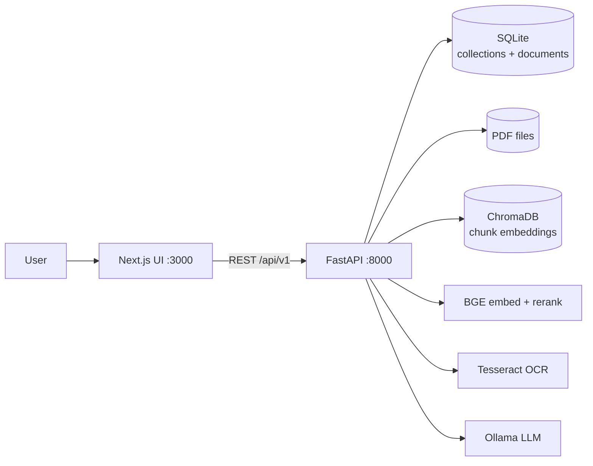
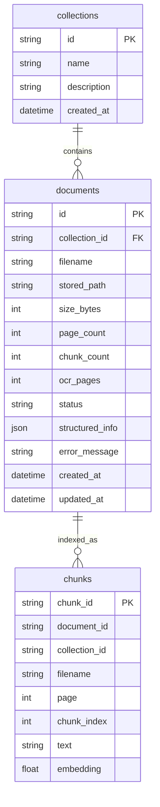
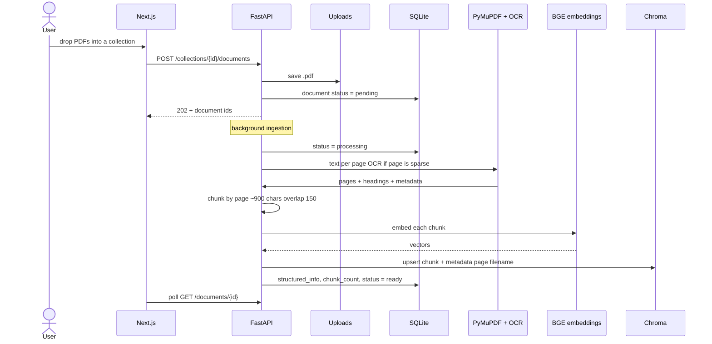
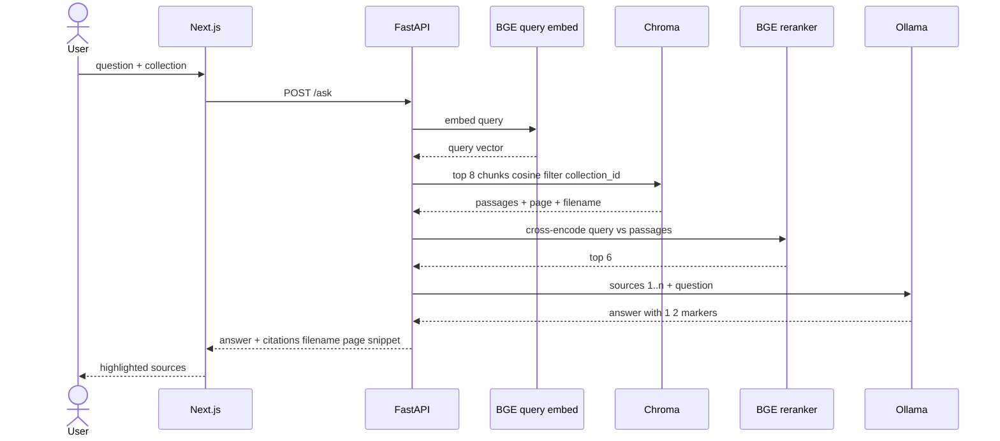
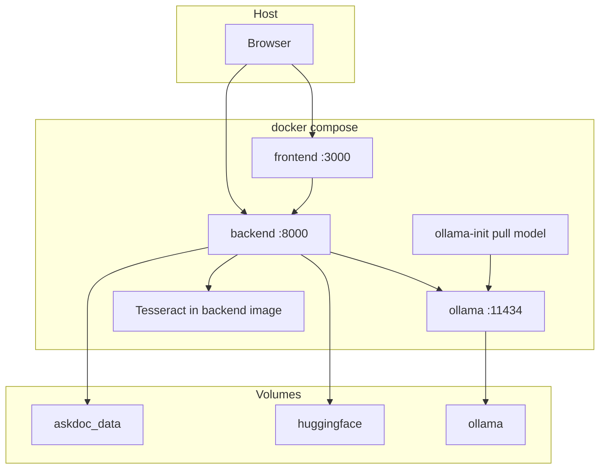

# AskDoc architecture

How the system ingests PDFs, stores them, and answers with citations.

## 1. System

The browser talks to the UI. The UI calls the API. The API owns files, metadata, vectors, and generation.

## 2. Data schema

SQLite holds **what** was uploaded. Chroma holds **searchable passages** (one vector per chunk).

`chunks` live in Chroma (`askdoc_chunks`), not SQLite. Status on a document is `pending → processing → ready | failed`.

`structured_info` JSON (from PDF metadata, headings, optional LLM):

- title, authors, date, language
- document_type, summary, key_topics, headings
- page_count, ocr_used

## 3. Upload / index

## 4. Ask with citations

Retrieve many, rerank to a short list, generate only from those passages. Inline `[n]` maps back to the ranked chunk.

## 5. Docker

## API map

| Call | Role |
|------|------|
| `POST /api/v1/collections` | Create a library |
| `POST /api/v1/collections/{id}/documents` | Upload PDFs, start indexing |
| `GET /api/v1/documents/{id}` | Status + structured info |
| `POST /api/v1/search` | Semantic search + rerank, no LLM |
| `POST /api/v1/ask` | RAG answer + citations |
| `GET /api/v1/health` | API, Ollama, OCR |
