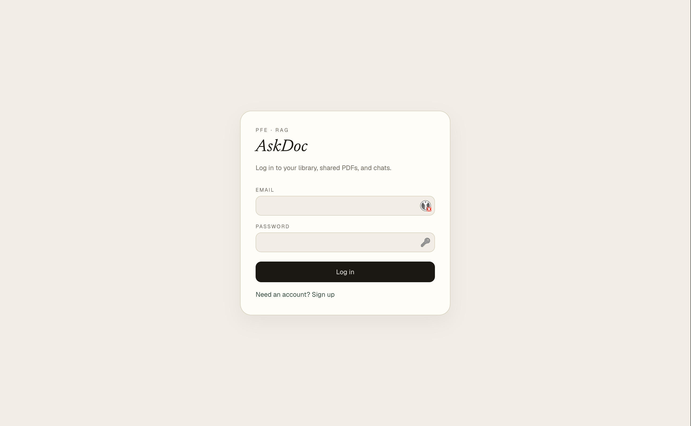
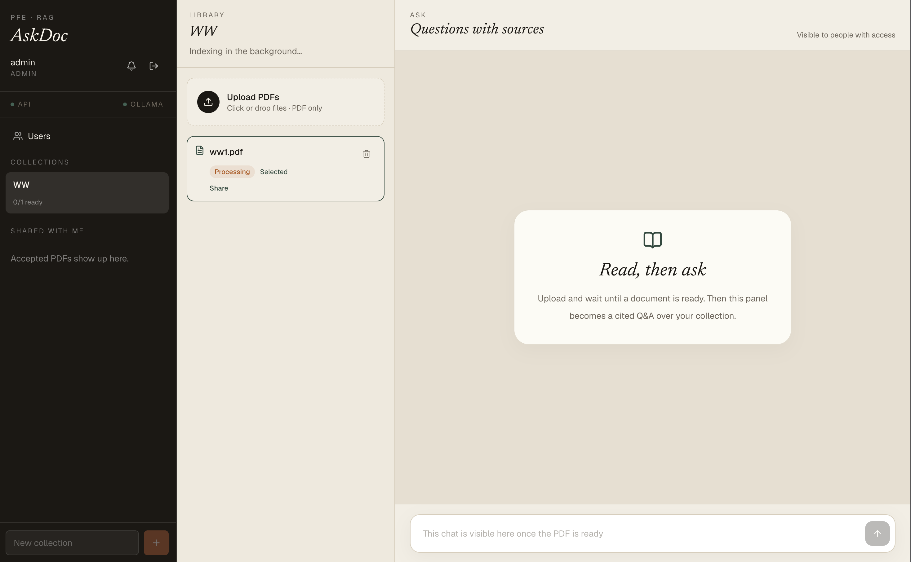
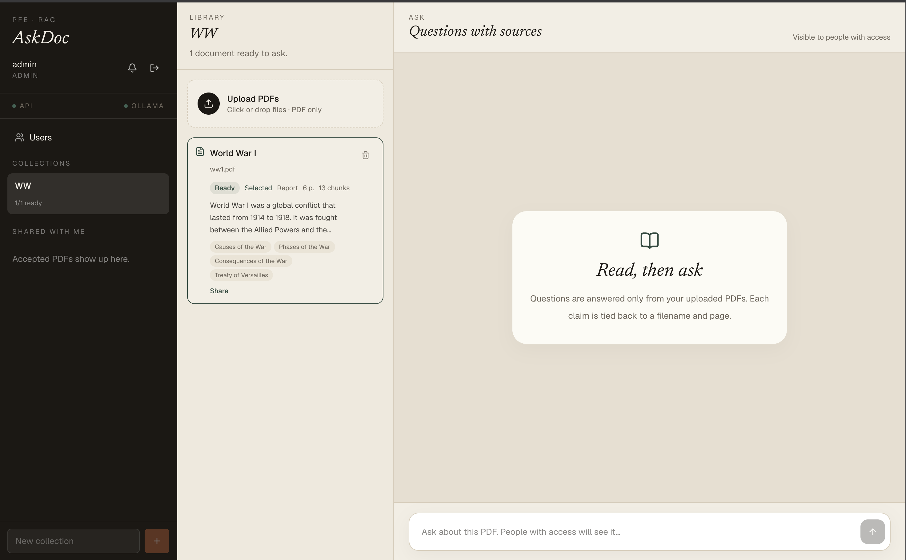
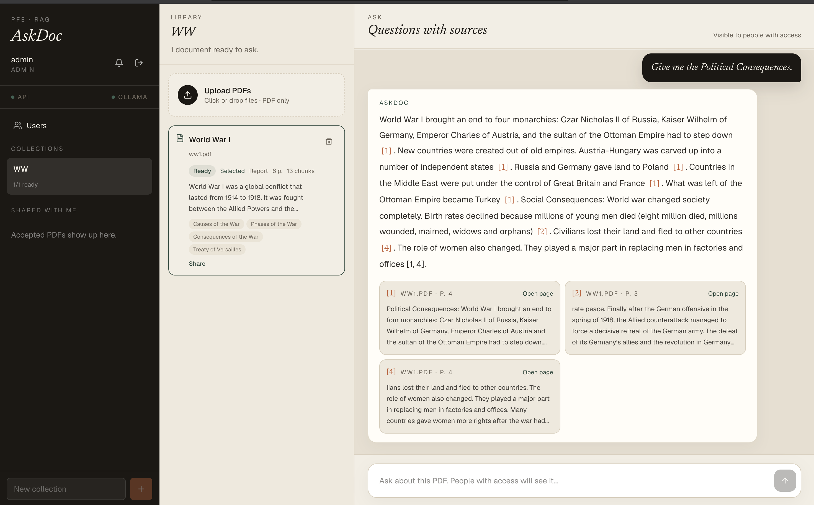

# AskDoc

PFE project: upload PDFs, extract structured information, search them semantically, and answer questions with source citations.

## What the app does

Sign in, drop PDFs into a collection, and wait while they are indexed. When a document is ready you get a short summary and topic tags. Ask a question and the answer cites the filename and page it came from. Chats stay on that collection and are visible to people who have access.

**Sign in** to your library of PDFs and chats.



**Upload a PDF.** Indexing runs in the background. Questions stay locked until the file is ready.



**Ready to ask.** The library shows page count, chunk count, a summary, and extracted topics.



**Questions with sources.** Each claim links back to a passage, with the filename and page.



```text
folio/
  backend/     FastAPI + Chroma + BGE + OCR
  frontend/    Next.js 16 UI
  nginx/       public entry on port 80
  docker-compose.yml
  ARCHITECTURE.md   schema + ingest/ask graphs
```

How it works (data model, ingest, RAG): [ARCHITECTURE.md](./ARCHITECTURE.md)

## Run everything with Docker

Needs Docker Desktop (or Docker Engine + Compose v2). Stop anything already bound to ports **80** or **11434**. First start pulls **Ollama**, **llama3.2:3b**, **PyTorch**, and the **BGE** models — several GB. Search models load in the background when the API starts.

```bash
cd folio
cp .env.example .env   # optional
docker compose up --build
```

Nginx is the public entry on port 80. It serves the Next.js app and proxies `$API_PREFIX` (default `/api/v1`), `/docs`, `/redoc`, and `/openapi.json` to the API. The session cookie is sent with those API calls, and nginx turns it into the bearer token the API expects. Responses get security headers. Hashed `/_next/static` files are cached for a year; HTML and API responses are not. PDF uploads up to 64 MB and the answer stream pass through without being buffered.

| Service | URL |
|---------|-----|
| App | http://localhost |
| API docs | http://localhost/docs |
| Ollama | http://localhost:11434 |

`ollama-init` pulls `${OLLAMA_MODEL:-llama3.2:3b}` once. You can upload PDFs while that finishes; `/ask` works after the model is on disk.

Scanned PDFs need OCR, which is off by default:

```bash
OCR_ENABLED=true docker compose up --build
```

Stop:

```bash
docker compose down
```

Keep indexed docs and models:

```bash
docker compose down   # volumes stay
```

Wipe data:

```bash
docker compose down -v
```

## Local development (without Docker)

**Backend** — Tesseract optional, [Ollama](https://ollama.com) required for answers:

```bash
cd backend
cp .env.example .env
uv sync
ollama pull llama3.2:3b
uv run uvicorn app.main:app --reload --port 8000
```

**Frontend:**

```bash
cd frontend
cp .env.example .env.local
bun install
bun run dev
```

Open http://localhost:3000

## Stack

- **Ingest:** PyMuPDF + Tesseract OCR fallback
- **Retrieve:** `BAAI/bge-small-en-v1.5` → ChromaDB → `BAAI/bge-reranker-base`
- **Generate:** Ollama (`llama3.2:3b` by default) with filename + page citations
